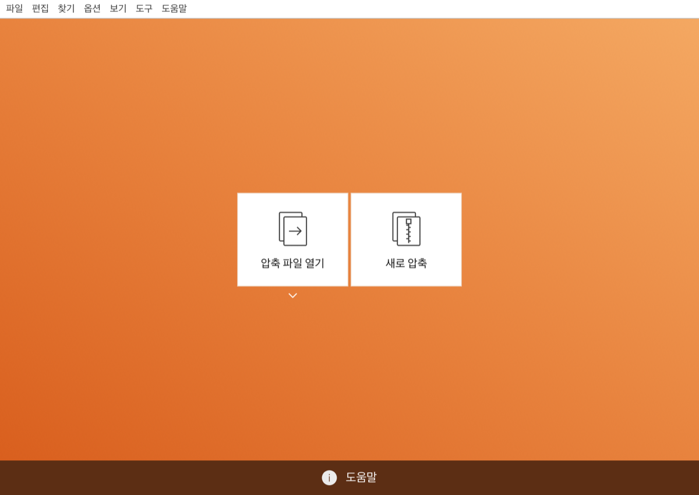
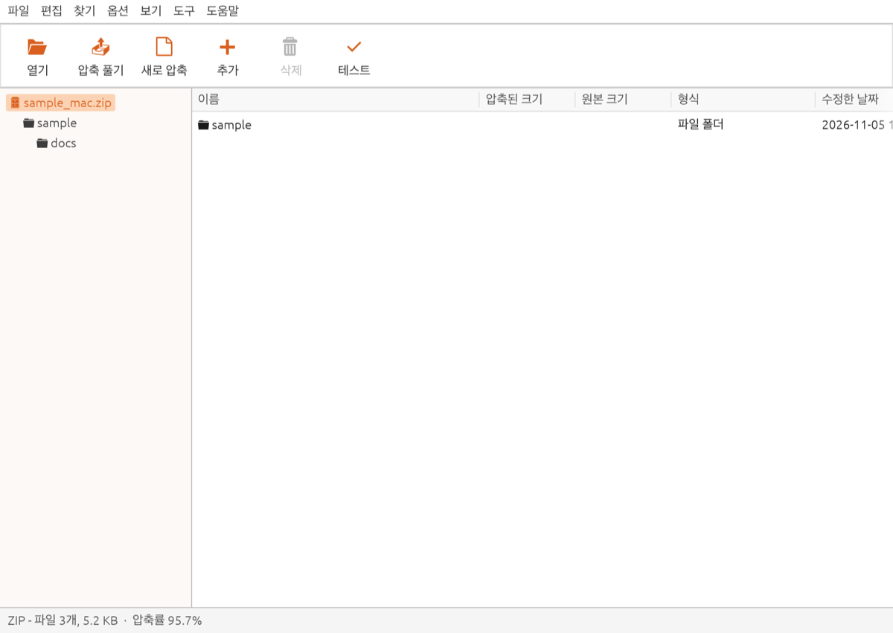

<p align="center">
  
</p>

<h1 align="center">tailzip · 꼬리집</h1>

<p align="center">
  Windows와 macOS에서 쓰는 가벼운 압축 프로그램 (Rust + egui)<br>
  A small archiver for Windows and macOS, written in Rust with egui
</p>

<p align="center">
  
  
</p>

[English](#english) · [한국어](#한국어)

---

## 한국어

### 지원 형식

| 형식 | 확장자 | 열기·목록 | 압축 풀기 | 새로 압축 | 파일 추가·삭제 | 테스트 |
|---|---|---|---|---|---|---|
| ZIP | `.zip` | ✅ | ✅ | ✅ (Deflate) | ✅ | ✅ |
| 7-Zip | `.7z` | ✅ | ✅ | ✅ (LZMA2) | ✅ | ✅ |
| TAR | `.tar` | ✅ | ✅ | ✅ | ✅ | ✅ |
| TAR + gzip | `.tgz`, `.tar.gz` | ✅ | ✅ | ✅ | ✅ | ✅ |

- 형식은 파일 앞부분의 서명으로 먼저 판별하고, 그다음 확장자로 판별합니다. 그래서 확장자가 달라도 내용이 ZIP이면 열립니다.
- 압축 수준은 4단계입니다: 0 무압축, 1 빠른 압축, 2 보통(기본), 3 최대 압축.
- **지원하지 않는 것**: 암호가 걸린 압축 파일, RAR·ZIPX·ALZ·EGG 등 그 밖의 형식, 분할 압축.

### 주요 기능

- 시작 화면에서 **압축 파일 열기** / **새로 압축**
- 폴더 트리와 파일 목록(이름, 압축된 크기, 원본 크기, 형식, 수정한 날짜, 압축 방식, CRC)
- 도구 모음: 열기, 압축 풀기, 새로 압축, 추가, 삭제, 테스트
- 창에 파일을 끌어다 놓아 열기·추가
- 한국어 / 영어 화면. 처음에는 시스템 언어를 따르고, **보기 ▸ 언어** 메뉴에서 바꿀 수 있습니다.
- 압축 파일을 고칠 때는 새 파일을 다 만든 뒤에 원본과 바꿔서, 중간에 실패해도 원본이 망가지지 않습니다.

### 설치

[Releases](https://github.com/BBQ-MAN/tailzip/releases)에서 받습니다.

- **macOS** (Apple 실리콘·Intel 공용, macOS 11 이상): `tailzip-<버전>-mac-universal.dmg`를 열고 `tailzip`을 응용 프로그램 폴더로 끌어 넣습니다.
  - Apple 공증을 받지 않은 앱이라 처음 실행할 때 경고가 뜹니다. **우클릭 ▸ 열기**로 한 번 실행하면 그다음부터는 그냥 열립니다.
  - Finder에는 언어 설정에 따라 "꼬리집" 또는 "tailzip"으로 보입니다.
- **Windows** (64비트, Windows 10 이상)
  - 설치 파일: `tailzip-<버전>-windows-x64-setup.exe`. 시작 메뉴와 바탕 화면 바로 가기를 만들고, 지원 형식의 "연결 프로그램" 목록에 등록합니다. 기본 프로그램은 바꾸지 않습니다.
  - 설치 없이 쓰기: `tailzip-<버전>-windows-x64-portable.zip`을 풀고 `tailzip.exe`를 실행합니다.
  - 서명하지 않은 실행 파일이라 SmartScreen 경고가 뜰 수 있습니다. **추가 정보 ▸ 실행**을 누르면 됩니다.

### 직접 빌드

Rust stable이 필요합니다.

```bash
cd app
cargo run --release                        # 실행
cargo test --release                       # 테스트
TAILZIP_LANG=ko cargo run --release        # 한국어로 실행 (en: 영어)
```

배포 파일 만들기(macOS에서):

```bash
bash packaging/make-icons.sh          # 아이콘(icns, ico) 다시 만들기
bash packaging/package-mac.sh         # dist/tailzip.app, dist/tailzip-<버전>-mac-universal.dmg
brew install mingw-w64 nsis
bash packaging/package-windows.sh     # dist/tailzip-<버전>-windows-x64-setup.exe, -portable.zip
```

### 폴더 구성

| 경로 | 내용 |
|---|---|
| `app/src/main.rs` | 화면(egui): 시작 화면, 도구 모음, 목록, 대화상자 |
| `app/src/archive.rs` | 형식 판별, 목록, 압축 풀기, 만들기, 추가, 삭제, 테스트 |
| `app/src/i18n.rs` | 한국어·영어 문구와 언어 선택 |
| `packaging/` | 아이콘, macOS 번들, Windows 설치 파일(NSIS) 스크립트 |

### 라이선스

[MIT](LICENSE). 앱 아이콘은 Codex CLI(이미지 생성)로 만들었습니다.

---

## English

### Supported formats

| Format | Extensions | Open / list | Extract | Create | Add / delete | Test |
|---|---|---|---|---|---|---|
| ZIP | `.zip` | ✅ | ✅ | ✅ (Deflate) | ✅ | ✅ |
| 7-Zip | `.7z` | ✅ | ✅ | ✅ (LZMA2) | ✅ | ✅ |
| TAR | `.tar` | ✅ | ✅ | ✅ | ✅ | ✅ |
| TAR + gzip | `.tgz`, `.tar.gz` | ✅ | ✅ | ✅ | ✅ | ✅ |

- The format is detected from the file signature first, then from the extension.
- Four compression levels: 0 store, 1 fast, 2 normal (default), 3 maximum.
- **Not supported:** password-protected archives, RAR, ZIPX, ALZ, EGG and other formats, split archives.

### Features

- Start page with **Open Archive** / **New Archive**
- Folder tree and file list (name, compressed and original size, type, modified, method, CRC)
- Toolbar: Open, Extract, New, Add, Delete, Test
- Drag and drop files onto the window to open or add them
- Korean and English interface: follows the system language; switch with **View ▸ Language**
- Archives are rewritten to a temporary file and swapped in only when complete, so a failure never damages the original

### Install

Download from [Releases](https://github.com/BBQ-MAN/tailzip/releases).

- **macOS** (universal, macOS 11+): open `tailzip-<version>-mac-universal.dmg` and drag `tailzip` to Applications. The app is not notarized: the first time, right-click ▸ Open.
- **Windows** (x64, Windows 10+): run `tailzip-<version>-windows-x64-setup.exe`, or unzip `tailzip-<version>-windows-x64-portable.zip`. The installer adds Start menu and desktop shortcuts and an "Open with" entry for the supported types without changing your default app. The executable is unsigned, so SmartScreen may ask: More info ▸ Run anyway.

### Build

```bash
cd app
cargo run --release
cargo test --release
TAILZIP_LANG=en cargo run --release   # force English (ko: Korean)
```

Packaging (on macOS): `packaging/make-icons.sh`, `packaging/package-mac.sh`, and with `brew install mingw-w64 nsis`, `packaging/package-windows.sh`.

### License

[MIT](LICENSE). The app icon was generated with Codex CLI.
